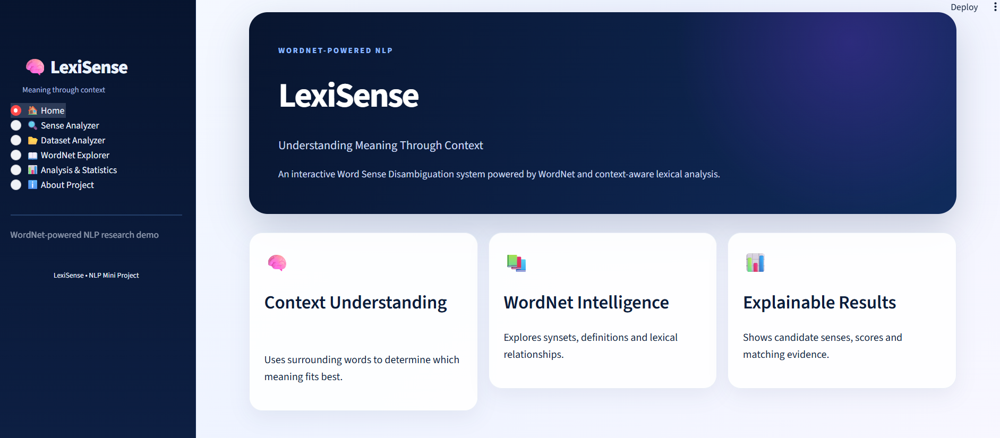
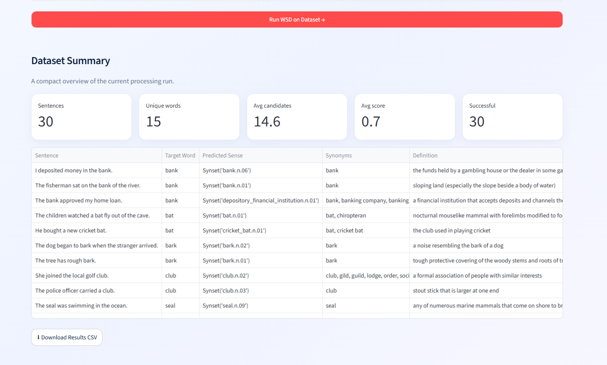
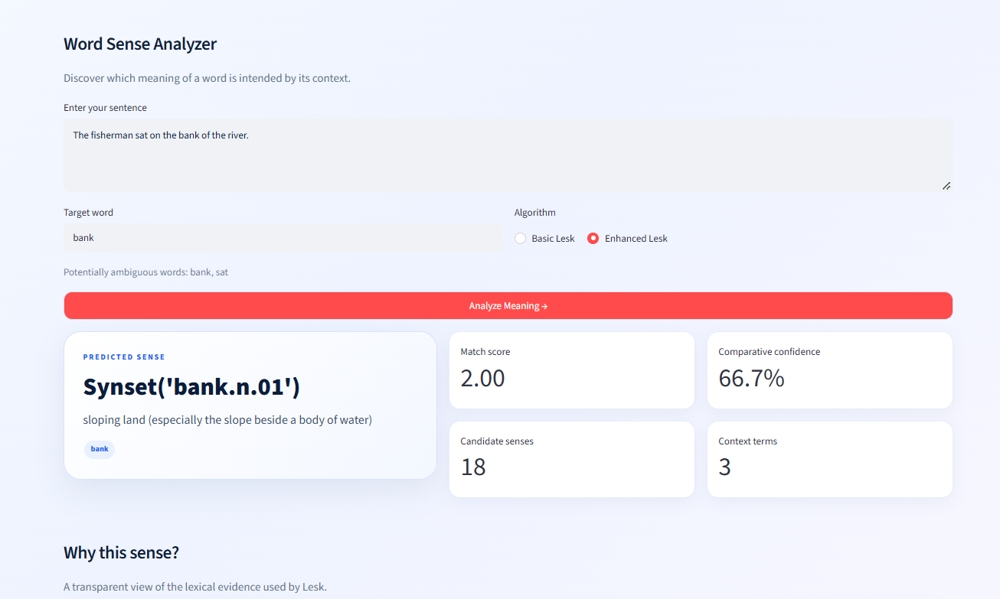
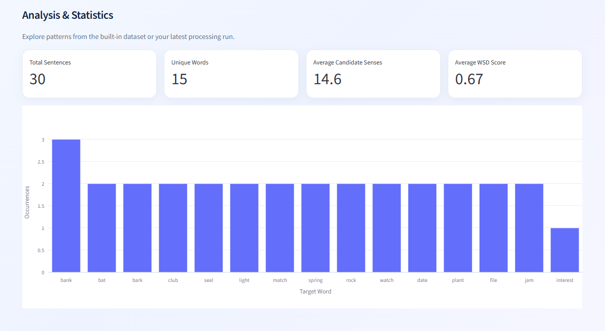

# 🧠 LexiSense – Word Sense Disambiguation using WordNet

### Understanding Meaning Through Context

LexiSense is an interactive Natural Language Processing (NLP) application that identifies the intended meaning of an ambiguous word based on its surrounding context. Built with **Python, Streamlit, NLTK, and WordNet**, the application uses Basic Lesk and Enhanced Lesk algorithms to compare contextual information with candidate word senses.

The project provides an intuitive interface for analyzing sentences, processing custom datasets, exploring lexical relationships, and visualizing word sense disambiguation results.

---

## ✨ Features

- **🔍 Single Sentence Analyzer** — Analyze a sentence and identify the intended meaning of a target word.
- **🧠 Basic Lesk Algorithm** — Select a candidate sense using contextual overlap with WordNet definitions and examples.
- **⚡ Enhanced Lesk Algorithm** — Improve contextual matching by considering additional lexical evidence.
- **📚 WordNet Explorer** — Explore synsets, definitions, lemmas, synonyms, hypernyms, hyponyms, antonyms, and examples where available.
- **📂 Dataset Analyzer** — Process the built-in dataset or upload custom CSV and TXT files.
- **📊 Interactive Analytics** — Visualize target-word frequencies, candidate senses, and WSD scores.
- **💡 Explainable Predictions** — Inspect the predicted sense, definition, match score, and contextual evidence.
- **⬇️ CSV Export** — Download annotated results for further analysis.
- **🎨 Modern Streamlit UI** — A polished interface with custom styling, interactive controls, and presentation-friendly visualizations.
- **🔌 No API Keys Required** — Uses local NLP processing and the WordNet lexical database.

---

## 🎯 Project Objectives

1. Develop a Word Sense Disambiguation system using NLTK WordNet.
2. Identify candidate senses for ambiguous words.
3. Apply Lesk-based algorithms to select a contextually appropriate sense.
4. Present predictions with definitions, lexical relationships, and matching evidence.
5. Support batch processing of user-provided text datasets.
6. Visualize WSD results through interactive charts and statistics.

---

## 🛠️ Tech Stack

| Technology | Purpose |
|---|---|
| Python | Core programming language |
| Streamlit | Interactive frontend |
| NLTK | NLP preprocessing and WordNet integration |
| WordNet | Lexical database for candidate senses and relationships |
| Pandas | Dataset processing and tabular results |
| NumPy | Numerical operations where required |
| Plotly | Interactive data visualizations |

---

## 🏗️ System Architecture

The application follows a modular pipeline:

```text
                 USER INPUT
                     |
          +----------+----------+
          |          |          |
      Sentence   Sample Data   CSV / TXT
          |          |          |
          +----------+----------+
                     |
             STREAMLIT FRONTEND
                     |
              TEXT PREPROCESSING
                     |
             TARGET WORD IDENTIFICATION
                     |
             WORDNET SYNSET RETRIEVAL
                     |
              CANDIDATE SENSES
                     |
          +----------+----------+
          |                     |
      Basic Lesk             Enhanced Lesk
          |                     |
          +----------+----------+
                     |
              SENSE SELECTION
                     |
             RESULTS FORMATTING
                     |
          +----------+----------+
          |          |          |
      Predicted   WordNet     Analytics
        Sense    Relations    & Charts
          |
      CSV EXPORT
```

### Main Components

- `app.py` — Streamlit interface, navigation, and application workflow.
- `src/wsd_engine.py` — Word Sense Disambiguation algorithms and candidate scoring.
- `src/wordnet_utils.py` — WordNet synset retrieval and lexical relationship utilities.
- `src/preprocessing.py` — Text normalization and preprocessing.
- `src/visualizations.py` — Charts and visualization helpers.
- `utils/helpers.py` — Reusable utility functions.
- `data/sample_wsd_dataset.csv` — Built-in sample dataset.

---

## 🧠 WSD Methodology

Word Sense Disambiguation determines which meaning of a word is intended in a particular context.

For example:

**Input sentence**

> The fisherman sat on the bank of the river.

**Target word:** `bank`

Possible interpretations include:

- A financial institution.
- Sloping land beside a river.

Since the sentence contains contextual clues such as *fisherman* and *river*, the system can favor the river-edge interpretation.

### 1. WordNet Synset Retrieval

The application retrieves candidate synsets from WordNet. Each synset represents a particular word meaning and provides lexical information such as definitions, lemmas, and examples.

### 2. Basic Lesk Algorithm

The Basic Lesk approach compares the context of the target word with the lexical information associated with each candidate sense.

A simplified scoring function is:

\[
\operatorname{Score}(s)=|C\cap G_s|
\]

where:

- \(C\) is the set of context terms.
- \(G_s\) is the set of lexical terms associated with candidate sense \(s\).

The candidate with the greatest overlap is selected.

### 3. Enhanced Lesk Algorithm

The Enhanced Lesk option uses additional lexical evidence, such as lemma names and example sentences, with enhanced weighting of meaningful contextual matches.

This can improve the quality of candidate ranking, although the result still depends on lexical overlap and the available WordNet information.

### 4. Result Explanation

The application presents the selected sense, its definition, matching score, candidate senses, and relevant lexical information to help users understand the prediction.

> **Note:** A Lesk match score is an algorithmic score, not necessarily a calibrated probability of correctness.

---

## 📂 Dataset

LexiSense includes a sample dataset containing **30 sentences across 15 ambiguous target words**.

Examples include:

`bank`, `bat`, `bark`, `club`, `seal`, `light`, `match`, `spring`, `rock`, `watch`, `date`, `plant`, `file`, `jam`, and `interest`.

The dataset contains different contexts for the same target word to demonstrate contextual ambiguity.

### Supported Upload Formats

**CSV**

The recommended format contains two columns:

```csv
sentence,target_word
"The bank approved my loan.",bank
"The fisherman sat on the bank of the river.",bank
"He bought a new cricket bat.",bat
```

A CSV containing only a sentence column can also be used where supported by the application's target-word selection or identification workflow.

**TXT**

Provide one sentence per line:

```text
The bank approved my loan.
The fisherman sat on the bank of the river.
He bought a new cricket bat.
```

The application processes each line as a separate sentence.

---

## 🚀 Installation and Setup

### Prerequisites

- Python 3.10 or later recommended.
- pip package manager.
- Visual Studio Code or another Python IDE.
- Internet access for the initial download of missing NLTK resources.

### Step 1: Clone the Repository

```bash
git clone https://github.com/YOUR_USERNAME/LexiSense_WSD.git
cd LexiSense_WSD
```

Replace `YOUR_USERNAME` with your GitHub username and adjust the repository name if necessary.

### Step 2: Create a Virtual Environment

```bash
python -m venv venv
```

### Step 3: Activate the Environment

**Windows PowerShell**

```powershell
venv\Scripts\Activate.ps1
```

**Windows Command Prompt**

```cmd
venv\Scripts\activate
```

**macOS / Linux**

```bash
source venv/bin/activate
```

### Step 4: Install Dependencies

```bash
python -m pip install --upgrade pip
pip install -r requirements.txt
```

### Step 5: Launch LexiSense

```bash
streamlit run app.py
```

Streamlit will display a local URL, usually:

```text
http://localhost:8501
```

Open the URL in your browser to access the application.

### NLTK Resources

The application checks for the required NLTK resources and attempts to download missing resources, including WordNet and OMW, automatically. Internet access may be required on the first launch.

---

## 🖥️ Using the Application

### 1. Home

Explore the project overview, application features, and navigation.

### 2. Sense Analyzer

1. Enter a sentence.
2. Enter the ambiguous target word.
3. Select Basic Lesk or Enhanced Lesk.
4. Click **Analyze Meaning**.
5. Inspect the predicted sense, definition, candidate scores, and contextual evidence.

### 3. Dataset Analyzer

1. Open the Dataset Analyzer.
2. Select the built-in dataset or upload a CSV/TXT file.
3. Validate and preview the input.
4. Run WSD on the dataset.
5. Review the annotated results.
6. Download the output as a CSV file.

### 4. WordNet Explorer

Select a word to inspect its available synsets, definitions, synonyms, examples, and lexical relationships.

### 5. Analysis & Statistics

Explore summary metrics and interactive charts generated from the available dataset or processing results.

---

## 📈 Example Result

| Field | Example |
|---|---|
| Sentence | The fisherman sat on the bank of the river. |
| Target word | bank |
| Predicted sense | `bank.n.01` |
| Definition | Sloping land beside a body of water |
| Algorithm | Enhanced Lesk |

The exact prediction and score depend on the WordNet version, implementation, and scoring configuration.

---

## 📸 Application Screenshots

Create a folder named `screenshots/` in the repository and add your application screenshots.

Recommended structure:

```text
screenshots/
├── home.png
├── dataset_analyzer.png
├── sense_analyzer.png
└── analytics.png
```

Embed them in this README using relative paths:

### Home Page



### Dataset Analyzer



### Sense Analyzer



### Analysis and Statistics



Ensure these image files are actually added to the repository; otherwise, the screenshot links will not render on GitHub.

---

## 📁 Project Structure

```text
LexiSense_WSD/
│
├── app.py
├── requirements.txt
├── README.md
├── .gitignore
│
├── data/
│   └── sample_wsd_dataset.csv
│
├── src/
│   ├── __init__.py
│   ├── wsd_engine.py
│   ├── wordnet_utils.py
│   ├── preprocessing.py
│   └── visualizations.py
│
├── utils/
│   └── helpers.py
│
└── assets/
    └── README.txt
```

---

## ⚠️ Limitations

- Lesk-based methods rely on lexical overlap and may struggle when context and definitions use different vocabulary.
- WordNet may not contain an appropriate synset for every word or usage.
- The system's score should not be interpreted as a calibrated probability.
- The built-in sample dataset demonstrates functionality but does not establish benchmark-level accuracy.
- The quality of predictions can vary with sentence structure and the selected target word.

---

## 🔮 Future Enhancements

- Evaluate performance on standard labelled WSD datasets.
- Add POS-aware candidate filtering.
- Compare Lesk with transformer-based contextual embeddings.
- Improve confidence estimation and error analysis.
- Support larger datasets and additional output formats.
- Add further lexical relationship visualizations.

---

## 📚 References

1. [NLTK WordNet Interface](https://www.nltk.org/howto/wordnet.html)
2. [NLTK Documentation](https://www.nltk.org/)
3. [Streamlit Documentation](https://docs.streamlit.io/)
4. Lesk, M. (1986). *Automatic Sense Disambiguation Using Machine Readable Dictionaries: How to Tell a Pine Cone from an Ice Cream Cone.*
5. [Plotly Python Documentation](https://plotly.com/python/)

---

## 👩‍💻 Project Information

**Project:** LexiSense – Word Sense Disambiguation using WordNet  
**Domain:** Natural Language Processing (NLP)  
**Interface:** Streamlit  
**Core Method:** Basic Lesk and Enhanced Lesk  
**Lexical Resource:** NLTK WordNet

---

## ⭐ Support

If you find this project useful for learning NLP and lexical semantics, consider giving the repository a star.

*LexiSense — Understanding Meaning Through Context.*
